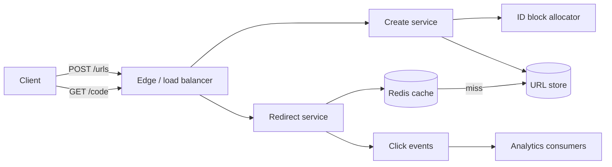

# Exercise 1: URL Shortener

Worked solution. Try the problem for 35 minutes before reading past the requirements. Method: [Lecture 6](../lectures/lecture-06-system-design-interviews.md).

## Problem

Design a service that turns a long URL into a short link and redirects the caller to the original URL.

In scope: create, redirect, optional expiry. Out of scope for the first design: user accounts, custom aliases, a full analytics product. We will say where those attach.

## Requirements

**Functional**

- `POST /urls` accepts a long URL and returns a short URL.
- `GET /{code}` responds with `301` or `302` to the long URL.
- A caller may set an expiry. Expired codes do not redirect.

**Non-functional**

- Redirect latency: p99 under 100 ms from the service region, excluding the client's distance to that region.
- Availability target for redirects: 99.9% (a few minutes a month). Creates can be slightly less available than redirects.
- A code, once issued and not expired, keeps pointing at the same long URL. We do not edit links in place.

## Capacity estimates

Assumptions, stated so they can be challenged:

- 100 million new URLs per day.
- Read:write ratio 100:1.
- Peak is 2× the average.
- A stored record is ~200 bytes (code, long URL averaging 100 bytes, owner, timestamps, expiry).
- Retention 5 years. Replication factor 3.

```
writes/sec   = 1e8 / 86400 ≈ 1,200 average, ≈ 2,400 peak
reads/sec    = 1,200 × 100 ≈ 120,000 average, ≈ 240,000 peak
records      = 1e8 × 365 × 5 ≈ 1.8×10^11
storage      = 1.8×10^11 × 200 B ≈ 36 TB raw, ≈ 110 TB with 3 copies
redirect bw  = 240,000 × ~500 B response ≈ 120 MB/s at peak, small
```

The number that drives the design is **~240k peak redirects/sec**. The write rate fits on one primary. The storage figure says we will need to shard within a few years, not on day one. Cache the hot tail: the most recent day of codes is 100 million × 200 B ≈ 20 GB, and a smaller hot set (links shared in the last hour) fits in a few gigabytes.

## API

```
POST /v1/urls
{ "url": "https://example.com/a-very-long-path", "ttl_seconds": 31536000 }
→ 201 { "code": "3Kx9Qa", "short_url": "https://short.example/3Kx9Qa", "expires_at": "..." }

GET /3Kx9Qa
→ 301 Location: https://example.com/a-very-long-path
→ 404 if missing
→ 410 if expired
```

Creates accept an `Idempotency-Key`. A retried create with the same key and the same URL returns the original code. A retried create with the same key and a different URL returns `409`. Redirects are safe to retry.

## Data model

```
urls
  code            CHAR(7)   PRIMARY KEY
  long_url        TEXT      NOT NULL
  created_at      TIMESTAMP
  expires_at      TIMESTAMP NULL
  idempotency_key TEXT      UNIQUE NULL
```

`code` is the partition key. The only hot query is a point read by code. There is no range scan on the redirect path.

Optional later, not on the redirect path:

```
clicks (code, ts, country, referrer)   -- append-only, derived
```

## Architecture



Redirects never wait for analytics. The click event is asynchronous and lossy: losing a click is acceptable, losing a mapping is not.

## Deep dive: generating codes

A 7-character base62 code has `62^7 ≈ 3.5×10^12` values. Five years of links use `1.8×10^11` of them, so the space is large enough that random generation rarely collides, but "rarely" at 1,200 writes/sec still means collisions you must handle.

**Chosen approach: block allocation.** A small coordinator (a single row in the database, or a lightweight service) hands each create-instance a block of integer IDs, for example 10,000 at a time. The instance mints IDs in memory and encodes them as base62. No coordination per request. If an instance dies, the unused tail of its block is skipped. Gaps are fine.

Why not the alternatives:

- **Hash the long URL** (first 7 chars of SHA-256, base62). Dedupes identical URLs, which we did not promise, and collides. A collision check is a read-before-write on the hot path, and two different URLs must never share a code. Rejected as the primary scheme. It is a reasonable optimization later if product wants "same URL, same code."
- **Random code plus unique index.** Simple, but at high occupancy the retry rate climbs, and every create pays for a uniqueness round trip. Fine at 1,200 writes/sec early on. The block allocator is the design we keep once create QPS grows.
- **Central counter per request.** Correct and becomes the bottleneck. The block allocator is that counter, amortized.

Base62 of a counter leaks creation order. If that matters, encrypt the counter with a block cipher (format-preserving) before encoding. Uniqueness is unchanged.

## Redirect path

1. Look up `code` in Redis. Hit: return `301` and emit a click event.
2. Miss: read the store. Missing → `404`. `expires_at` in the past → `410` and a short negative cache entry.
3. Fill Redis with a TTL. The TTL is `min(cache cap, time-to-expiry)`, with a cap of one day so a mistaken mapping does not live forever.

Cache failure: redirects fall through to the store and replicas. The store must be sized to absorb a cache flush (thundering herd). Mitigations: request coalescing on the same code, and jittered TTLs so keys do not expire together.

A single primary plus replicas handles 1,200 writes/sec. Read replicas are not on the steady-state redirect path; the cache is. Replicas exist for cache rebuilds and for the day the cache is down.

When storage approaches the size of one node, hash-partition `code` across shards. The cache key is already `code`, so the application change is the routing function. Consistent hashing keeps a reshard from moving every key.

## Trade-offs

| Decision | Gain | Cost |
|----------|------|------|
| Cache in front of redirects | p99 under 100 ms at 240k peak reads/sec | A new link is invisible until the writer fills the cache, or until TTL if we failed to fill. We write-through on create for the creating region. |
| Block IDs instead of hashing the URL | No collision ambiguity, no read-before-write | Same long URL can get many codes. Dedup is a product feature we deferred. |
| Async, lossy click stream | Redirects stay fast and available | Analytics under-count during a bus outage. |
| `301` for unchanging links | Browsers and intermediaries cache | A takedown is slow to propagate. Abuse and legal removals use `302` plus a short TTL, or an explicit ban list checked at the edge. |
| Single-region primary | Simple consistency for creates | Create latency for distant users. Redirects are cached at the edge, so read latency is a regional problem and writes are not. |

## Failure and abuse

- **Store down:** redirects serve from cache until TTL. Creates fail. This matches the availability split in the requirements.
- **Duplicate create on retry:** idempotency key, unique in the store.
- **Open redirect and malware:** the long URL is attacker-controlled content. Scan asynchronously, and keep a denylist of codes that the edge checks before the cache. Do not make the safety scan part of redirect latency.
- **Hot code** (a link on a television broadcast): one key can exceed a shard's cache CPU. The edge cache, one layer in front of Redis, absorbs that. One Redis node is not the public edge.

## Follow-ups

1. **Collisions.** Block allocation does not collide. If you use random codes, the unique primary key rejects the loser and the service retries with a new code.
2. **Expiry.** `expires_at` checked on read, plus a daily job that deletes rows past retention so storage matches the five-year assumption. Expired rows return `410`.
3. **Analytics.** Append-only events keyed by code, aggregated offline. Not on the redirect critical path.
4. **Infinite or chained redirects.** Store only absolute `http(s)` URLs. Reject codes that point at the short domain. Cap nothing else in the redirector; the browser already limits hops, and we are not a proxy.

## Related reading

- [Lecture 1: Designing for Scale](../lectures/lecture-01-designing-for-scale.md)
- [Lecture 3: Database Selection](../lectures/lecture-03-database-selection.md)
- [YouTube video delivery](../../case-studies/youtube-video-delivery.md) — a different read-heavy, cache-heavy path, useful as a contrast once URLs grow into media.
