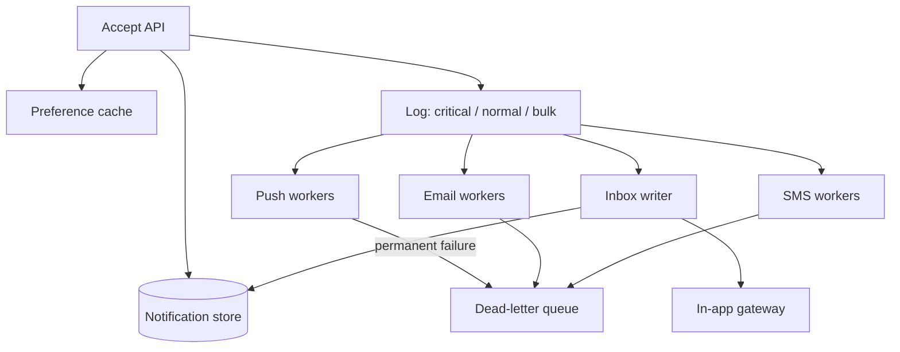

# Exercise 2: Real-Time Notification System

Worked solution. Try the problem for 35 minutes before reading past the requirements.

## Problem

Deliver notifications to users in near real time across push, email, SMS, and an in-app inbox. Critical alerts (account takeover, payment failure) jump ahead of marketing.

In scope: accept a notification, fan it out to the user's enabled channels, retry, and expose read state for the in-app inbox. Out of scope: the marketing campaign tool that decides who to message, and the third-party providers themselves.

## Requirements

**Functional**

- A producer calls "notify this user, with this template and payload, at this priority."
- The user has channel preferences and a quiet-hours setting. Security alerts ignore quiet hours.
- Failed deliveries retry. Permanent failures land in a dead-letter queue.
- In-app notifications can be listed and marked read.

**Non-functional**

- Critical: visible to the provider within 1 second, p99, when the device is reachable.
- Normal: within 10 seconds.
- Do not drop accepted critical notifications. Marketing may be shed under load.
- Peak accept rate: 100,000 notifications/sec average design point, with headroom to 1,000,000/sec by adding consumers. (A sustained 1,000,000/sec is a different budget; the estimate below shows why.)

## Capacity estimates

```
accept rate        = 1e5 / sec sustained design point
payload            = ~1 KB (ids, template, params; not rendered bodies)
ingress            = 1e5 × 1 KB ≈ 100 MB/s
fan-out            = assume 1.5 channel attempts per notification
provider calls     = 1.5e5 / sec
inbox retention    = 30 days, 20% of notifications are in-app
inbox rows / day   = 1e5 × 86400 × 0.2 ≈ 1.7×10^9
inbox storage      = 1.7×10^9 × 30 × 500 B ≈ 26 TB/month of retention, before replicas
```

100 MB/s of log ingress is a normal Kafka-sized problem. 1,000,000/sec would be ~1 GB/s and about 86 billion notifications a day, which forces a dedicated multi-cluster log and a hard look at whether marketing belongs in the same pipeline. The design below shards by priority so that question has a seam.

Provider rate limits, not our CPU, cap SMS. Treat SMS as a quota problem ([Lecture 4](../lectures/lecture-04-rate-limiting.md)).

## API

```
POST /v1/notifications
Idempotency-Key: producer-event-id
{
  "user_id": "u_42",
  "type": "payment_failed",
  "priority": "critical",
  "template": "payment_failed",
  "params": { "amount": "12.00" },
  "dedup_key": "payment_failed:ch_123"
}
→ 202 { "notification_id": "n_9f3" }

GET  /v1/inbox?cursor=...     → undelivered-to-the-eye list
POST /v1/inbox/{id}/read
```

`dedup_key` is how a producer avoids sending "payment failed" twice when its own retry fires. It is unique per user for a window of one day. The idempotency key is how *this* HTTP call is safe to retry; the two keys are not the same.

## Data model

```
notifications
  id, user_id, type, priority, template, params, dedup_key, created_at
  PRIMARY KEY (id)
  UNIQUE (user_id, dedup_key)

deliveries
  notification_id, channel, status, attempts, next_attempt_at, provider_id

inbox
  user_id, notification_id, created_at, read_at
  PRIMARY KEY (user_id, created_at, notification_id)

preferences
  user_id → { push, email, sms, quiet_hours, locale }
```

`inbox` is partitioned by `user_id`. Listing a mailbox is a range read on one partition. `notifications` is the source of truth for "we accepted this." Channel state lives in `deliveries`, because each channel fails independently.

## Architecture



Three topics (or one topic with a priority key and separate consumer groups that can be scaled independently). Critical has its own consumers and its own provider credentials so a marketing backlog cannot fill the critical queue. This is the same separation Slack-style systems make between interactive messages and background work; see [Slack's queue](../../case-studies/slack-message-queue.md).

## Deep dive: delivery semantics

Providers are at-least-once and often have no idempotency. Our side:

1. Insert `notifications` and the `deliveries` rows in one transaction, status `pending`. The unique `(user_id, dedup_key)` rejects a duplicate producer event.
2. Append to the log *after* the commit. If we crash between commit and append, a sweeper republishes rows stuck in `pending`. Republish is safe because workers key off `notification_id + channel`.
3. A worker calls the provider, then sets `sent` with the provider's id. A retry that sees `sent` does not call again.
4. Transient errors (timeout, 429, 5xx) schedule `next_attempt_at` with exponential backoff and jitter, capped (for example 6 tries over 30 minutes).
5. Permanent errors (400, unregistered device, hard bounce) go to `failed` and the dead-letter topic for a human or a fallback channel.

Critical bypasses the bulk topic entirely. It does not bypass the database row. "Skip the queue" means "use the short queue," not "send inline in the API request." Inline sends couple accept-latency to APNs and make retries the client's problem.

**In-app real time.** The inbox writer appends the row, then publishes to the user's connection on the gateway. If no connection is open, the row is still there for the next `GET /inbox`. The socket is an optimization on top of the store, the same pattern as the [WebSocket lab](../../course-05-realtime-systems/labs/websocket-streaming). Presence is not required for correctness.

**Device tokens and email addresses** are fetched by the worker, not stuffed into the event, so a token rotation between accept and send is visible.

## Trade-offs

| Decision | Gain | Cost |
|----------|------|------|
| Separate topics by priority | Critical stays inside 1 second while marketing backs up | Three times the operational surface. Worth it because the latency budgets differ by 10×. |
| Database row before the log | We can sweep and recover a lost append | Accept path does a write. At 1e5/sec this is a partitioned store, keyed by `user_id` so a user's dedup check is local. |
| At-least-once to providers, idempotent workers | No silent loss on timeout | Users can still see a duplicate if the provider applied the call and the response was lost, and the provider itself is not idempotent. We pass our `notification_id` where the provider allows an idempotency key, and we accept rare duplicates for email. |
| Inbox partitioned by user | Mailbox reads are one partition | A global "unread count across the product" is an offline job, not a query. |
| Shed bulk first | Critical and the cluster survive | Marketing delivery rate drops during an incident. That is the point. |

## Failure

- **Worker crash mid-send:** the row stays `pending` or returns to it on lease expiry. Another worker retries.
- **Preference service down:** fail closed for marketing (do not guess consent), fail open to the last cached preference for critical security alerts, which ignore quiet hours anyway.
- **Hot user** (a celebrity inbox, or a bug that notifies one id at 50k/sec): the `user_id` partition becomes hot. Rate-limit accepts per user, and shard the inbox of whale users by `(user_id, day)` if a single partition's storage grows without bound.
- **Region loss:** accept in the user's home region ([Lecture 2](../lectures/lecture-02-global-multi-region.md)). Push providers are global. The log is replicated asynchronously; a region loss can delay, not invent, a critical notification. The sweeper in the surviving region rebuilds from the store.

## Follow-ups

1. **Duplicates.** `(user_id, dedup_key)` at accept time, plus provider idempotency keys where they exist.
2. **Preferences.** Cached with the user record. Writes to preferences are rare and go through the source of truth; the cache TTL is short (minutes) and security sends ignore marketing opt-out.
3. **Priority.** Separate topics and consumer pools, not a flag checked after a shared backlog.
4. **Success rate.** `sent / accepted` by channel and priority, plus age of the oldest pending critical row. The oldest-pending metric pages a human. The ratio is the dashboard.

## Related reading

- [Lecture 4: Rate Limiting](../lectures/lecture-04-rate-limiting.md) — provider quotas.
- [Kafka event streaming](../../case-studies/kafka-event-streaming.md) — the log the topics sit on.
- [WhatsApp messaging](../../case-studies/whatsapp-messaging-system.md) — a different point in the design space, where the message *is* the product and the connection count dominates.
