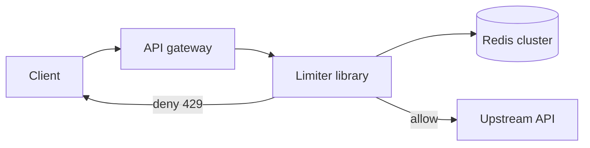

# Exercise 3: Rate Limiter

Worked solution. Try the problem for 35 minutes before reading past the requirements. Concepts: [Lecture 4](../lectures/lecture-04-rate-limiting.md).

## Problem

A service in front of an API that decides, in under 10 ms, whether a caller may proceed. Limits differ by tier. The decision is enforced across many API servers, not inside one process.

In scope: allow or deny, per key, per rule. Out of scope: billing quotas over a month, and DDoS scrubbing at the packet layer (see [Cloudflare](../../case-studies/cloudflare-ddos-defense.md) for that layer).

## Requirements

**Functional**

- Rules of the form "N requests per window" for a key (API token) and a route group.
- Tiers: free 60/min, paid 600/min, enterprise 6,000/min. A global safety limit sits underneath, per IP and per service.
- Deny with `429` and `Retry-After`.

**Non-functional**

- Decision p99 under 10 ms, including the hop to the shared store.
- 10 million active keys in a window. The keyspace of all customers can be larger; idle keys should not consume memory.
- Accuracy: never *meaningfully* exceed the limit. A few percent over, briefly, is acceptable. A 10× over because we counted locally on each instance is not.
- If the limiter store is unavailable, unauthenticated writes fail closed; authenticated reads fail open for a few seconds using a cached allow.

## Capacity estimates

```
API fleet QPS          = 200,000 decisions/sec at peak
Redis ops              = 1 atomic op per decision → 200,000 ops/sec
payload                = a few hundred bytes per op
bandwidth              = well under 1 Gbit/s
active keys            = 1e7
memory per key         = ~100 B of bucket state and key overhead ≈ 1 GB
plus replication       = 3 nodes, shards by key hash
```

200k simple Redis operations per second is within a small sharded cluster. The latency budget is the real constraint: the API server must be in the same region as the shard it calls. A cross-region limiter check will not make 10 ms.

## API

This is an internal API. Applications can also link the client library and talk to Redis; the decision shape is the same.

```
POST /v1/check
{ "key": "token_abc", "tier": "paid", "route": "search", "cost": 1 }
→ 200 { "allow": true,  "remaining": 540, "reset_ms": 12000 }
→ 200 { "allow": false, "retry_after_ms": 80 }

Response to the outside caller on deny:
429 Too Many Requests
Retry-After: 1
{ "error": "rate_limited", "retry_after_ms": 80 }
```

`cost` lets an expensive route consume more than one token (search costs 5, a health check costs 0 and is not limited).

## Data model

One Redis hash or string per `(key, rule)`, no relational store on the hot path.

```
key:    rl:{rule}:{token}
value:  tokens (float), last_refill_ms (int)
TTL:    several windows, so idle keys disappear
```

Rules themselves (the N and the window for a tier) live in config, shipped with the service. They change rarely. Do not look them up in a database per request. The token carries the tier claim, issued at authentication time.

## Architecture



The library runs in the gateway process. A separate limiter fleet would add a hop we do not have budget for. Redis is the shared state.

## Deep dive: token bucket, atomically

Per key, store `tokens` and `last_refill_ms`.

On each check, inside one Redis script (so two gateways cannot both spend the last token):

1. `now` from Redis `TIME`, not from the application clock.
2. `elapsed = now - last_refill_ms`.
3. `tokens = min(capacity, tokens + elapsed * refill_per_ms)`.
4. If `tokens >= cost`, subtract `cost` and allow. Else deny, and set `retry_after` from the deficit and the refill rate.
5. Write the new state and refresh the TTL.

**Why token bucket.** A paid client may burst up to `capacity` (set equal to the per-minute allowance, or to a few seconds of it) and then proceed at a steady refill. That matches API traffic better than a leaky bucket, which queues, or a fixed window, which doubles the allowed rate at the minute boundary.

**Sliding window counter**, if the product insists on "no more than 600 in any 60 seconds" rather than "600 per minute with a burst":

```
previous = count in the previous 60s window
current  = count in this window
weight   = fraction of the previous window still inside the rolling 60s
estimate = current + previous * weight
```

One extra key, still O(1), still one script. We start with token bucket and switch a rule to the sliding counter only if abuse at the boundary shows up.

**Clocks.** Using Redis `TIME` inside the script removes app-server skew. Redis replicas can lag; point limiter clients at a primary for each shard, or accept that a failover can briefly mis-count. A few percent is inside the accuracy requirement. Do not run the script against a stale replica.

**Sharding.** Hash the token onto a Redis shard. A hot token (one enterprise key at 6,000/min) is trivial. A hot *shard* happens if the hash is bad or if a single key is a shared anonymous bucket. Cardinality of the key is the fairness property; do not limit all free users under one key.

## Trade-offs

| Decision | Gain | Cost |
|----------|------|------|
| Shared Redis, one script | The limit holds across the gateway fleet | A regional Redis dependency on the critical path. Mitigated by timeout (2 ms) and the fail-open / fail-closed policy below. |
| Token bucket | Bursts work, memory is O(keys) not O(requests) | A client can send `capacity` instantly. Set `capacity` to the largest burst you will actually tolerate, not to "unlimited." |
| Fail open on reads when Redis errors | A Redis incident does not take down the product | A short window of unlimited read traffic. Pair with a coarse local safety cap (for example 5× the normal rate per process) so one bug cannot melt the API. |
| Fail closed on unauthenticated writes | Credential stuffing and card testing stop when we are blind | Those endpoints are down if Redis is down. Run Redis with replicas and a fast failover. |
| Tier inside the token | No user-database read on the hot path | A tier upgrade applies at token refresh, not instantly. Say so in the product. |

## Failure

- **Redis timeout:** apply the policy above. Measure the error rate of the limiter as its own SLO. A limiter that fails open silently is an incident you cannot see.
- **Clock skew across gateways:** irrelevant, because refill uses Redis time.
- **Gateway fleet doubles overnight:** the limit does not double with it, which is the bug an in-process counter would have.
- **Hot route rather than hot user:** a separate rule on the route (`rl:route:search` global) protects the dependency even if every caller is under their own limit. This is the "safety limit" versus "product limit" split from the lecture.

## Follow-ups

1. **Clock skew.** Redis `TIME` in the script. Document replica failover as a brief accuracy blip.
2. **Different limits per endpoint.** The rule id is part of the key. Search and writes do not share a bucket unless you want them to.
3. **Burst plus sustained rate.** Token bucket: `capacity` is the burst, `refill` is the sustained rate. State both numbers in the rule, not one.
4. **Redis down.** Fail closed on dangerous routes, fail open with a local safety cap on reads, page on limiter error rate. Do not block the request thread retrying Redis more than once.

## Related reading

- [Lecture 4: Rate Limiting, Throttling, and Quotas](../lectures/lecture-04-rate-limiting.md)
- [Lecture 5: Security Architecture](../lectures/lecture-05-security-zero-trust.md) — limits are a security control, not only a capacity control.
- [Shopify flash sales](../../case-studies/shopify-flash-sale-scaling.md) — fairness when bots and humans share a checkout.
