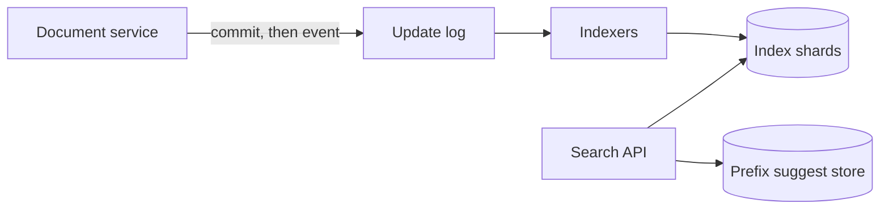

# Exercise 4: Full-Text Search Engine

Worked solution. Try the problem for 35 minutes before reading past the requirements.

## Problem

Search 100 million documents (articles, products, or short posts) by keywords, with typo-tolerant suggestions, filters, and relevance ranking. Return results in under 500 ms, suggestions in under 100 ms, at 10,000 queries per second.

In scope: indexing, query, rank, filter, autocomplete. Out of scope: crawling the open web, and training a learning-to-rank model. We will leave a seam for a ranker.

This is the shape of [GitHub code search](../../case-studies/github-code-search.md) and of product search such as [Airbnb](../../case-studies/airbnb-search-platform.md), with the hard parts made explicit.

## Requirements

**Functional**

- Full-text query across title and body.
- Filters: time range, category, author or tenant. Filters are conjunctive.
- Rank by relevance, with title matches ahead of body matches.
- Autocomplete / suggestions from a prefix.
- New and updated documents become searchable within one minute.

**Non-functional**

- Search p99 under 500 ms at 10,000 queries/sec.
- Suggestion p99 under 100 ms.
- Index is derived. The document store remains the source of truth. A destroyed index can be rebuilt.
- Per-tenant isolation for a multi-tenant corpus: tenant A must not see tenant B's documents. We assume a `tenant_id` on every document.

## Capacity estimates

```
documents          = 1e8
stored document    = 2 KB of indexed text on average (title + body tokens + stored fields)
inverted index     = roughly the same order as the text, call it ~2 KB/doc → ~200 GB
plus replicas      = 2 copies for serving → ~400 GB
queries            = 1e4 / sec average, peak 2e4 / sec
query fan-out      = if a query hits every shard, 2e4 × shard count is the real QPS
indexing           = assume 1% of the corpus updated per day → 1e6 updates/day ≈ 12 writes/sec average
                     peak during a backfill: design the pipeline for 5,000 docs/sec
```

12 writes/sec steady-state is not the indexing problem. The problem is **query fan-out** and **rebuilds**. A 200 GB index fits on a handful of machines. 10,000 queries/sec of fan-out across too many shards will not.

Autocomplete is a different working set: prefixes of popular queries, tens of gigabytes at most, served from memory.

## API

```
POST /v1/search
{
  "tenant_id": "t_1",
  "q": "wool running shoes",
  "filters": { "category": "shoes", "updated_after": "2026-01-01" },
  "limit": 20,
  "cursor": null
}
→ 200 {
  "hits": [ { "id": "d_9", "title": "...", "score": 12.4, "snippet": "..." } ],
  "next_cursor": "..."
}

GET /v1/suggest?tenant_id=t_1&prefix=wool+run
→ 200 { "suggestions": ["wool running shoes", "wool runner"] }
```

Search is a GET in spirit but a POST here so filters do not live in a query string. It is safe to retry. Indexing is internal:

```
POST /internal/index   { "id", "tenant_id", "version", "title", "body", "category", "updated_at" }
```

`version` makes the update idempotent. An older version arriving late must not overwrite a newer one.

## Data model

Source of truth (not the index):

```
documents
  id, tenant_id, version, title, body, category, updated_at, deleted
```

Index (derived), per shard:

- Inverted index: `term → postings (doc_id, field, term_frequency, positions)`.
- Stored fields for snippet and filter: `doc_id → { title, category, updated_at, tenant_id }`.
- Doc-values (columnar) for filters so a category constraint does not require loading postings for every candidate.

Partition the index by `hash(doc_id)`, not by term. Term partitioning puts "the" on one machine. Document partitioning means every shard answers every query, and we merge the top K. With a 200 GB index, start with **8 primary shards and 1 replica**: each query fans out to 8, which at 20k peak queries is 160k shard-queries/sec, about 20k per shard. That is comfortable for a term lookup plus a small ranking pass. If the corpus grows 10×, add shards, knowing that fan-out grows with them. The alternative, scattering only to shards that can contain the tenant (`hash(tenant_id)`), is better when one tenant's data is the usual query. **We partition by `tenant_id`** so a query has a fan-out of 1 in the common case. Large tenants are split into sub-shards (`tenant_id` plus a bucket) when they exceed one machine.

## Architecture



The document service commits first, then appends an event that carries the version. Indexers are consumers. Search never reads the document database on the query path.

## Deep dive: query execution

1. Normalize the query: lowercase, strip stop-words for ranking but keep them available, split on whitespace.
2. Route to the tenant's shard.
3. Intersect postings for the required terms, then apply filters on doc-values (`category`, time range, `deleted = false`).
4. Score the survivors with BM25 on title and body, with title boosted (for example title weight 3, body weight 1).
5. Return the top 20. Do not deep-page with `offset = 10000`; use a cursor on `(score, doc_id)` and cap the walk. Deep offsets are how search falls over.

**BM25**, in one sentence you can say out loud: a term helps a document's score when it appears often in that document, rarely in the corpus, and the document is not padded with unrelated length. You do not need to write the formula in the interview. You do need to say that IDF is a corpus statistic the shard must have, which is natural when the shard holds the whole tenant.

**Typos.** Two different features:

- **Suggestions** (under 100 ms): a small in-memory structure of popular queries and titles for that tenant, queried by prefix (an edge-ngram or a completion trie). This is the `suggest` store, built from query logs and titles, not from a scan of the inverted index.
- **Query-time typo tolerance:** for a term with few postings, expand to terms within edit distance 1 that exist in the dictionary. Cap the expansion (the most frequent few candidates). Do this only when the original term matches almost nothing, or latency will explode. Edit distance 2 on a 100 million document dictionary is not a 500 ms feature unless you precompute it.

**Updates.** The indexer applies events in version order per document. Deletes are a tombstone that a merge eventually drops. Because the freshness target is one minute, we do not need the document write and the index write in one transaction. We do need a lag metric: age of the oldest unindexed event. If it exceeds one minute, that is the paging signal.

**Rebuild.** An indexer can reconstruct a shard by scanning the document store for that tenant. Until the rebuild finishes, the replica serves. This is why the index is not the source of truth.

## Trade-offs

| Decision | Gain | Cost |
|----------|------|------|
| Partition by tenant | Query fan-out is 1, isolation is structural | A huge tenant needs explicit sub-sharding. A tiny tenant wastes little, because shards are shared by many tenants whose ids hash together; isolation is by filter *and* by not returning other tenants' ids, tested in the query layer. |
| Derived index, async | Document writes stay transactional and simple | Search is stale by up to the lag target (1 minute). A user who just edited may not see the edit; the editor reads from the document store, not from search. |
| BM25 with a title boost, not an ML ranker | Explainable, no feature pipeline on the critical path | Weaker relevance on ambiguous queries. The seam is: BM25 produces the top 200, a ranker may reorder later. We do not block v1 on the ranker. |
| Cursor pagination | Stable latency | Clients cannot jump to page 500. Acceptable for this product. |
| Typo expansion only on rare terms | Suggestions stay fast | A popular misspelling of a common word is handled by the suggestion store, not by expanding postings. |

## Failure

- **Shard down:** serve the replica. If both are down, that slice of tenants returns an error; other tenants are unaffected. This is the cell argument applied to search.
- **Indexer lag:** queries stay correct relative to the index, and the lag SLO tells us we are missing the freshness requirement. We do not fall back to scanning the document database; that path will not survive 10k QPS.
- **Poison document** (a 500 MB body): reject at ingest over a size cap so one document cannot explode a shard's merge.

## Follow-ups

1. **Freshness.** Versioned events, idempotent indexer, lag SLO of one minute, rebuild from the document store.
2. **Typos.** Prefix suggest store for the 100 ms path; bounded edit-distance expansion only when a term is rare.
3. **Pagination.** Cursor on score and id, never a large offset.
4. **Title versus body.** Field-level BM25 weights. Positions also let you require a phrase (`"running shoes"`) without a separate system.

## Related reading

- [Lecture 3: Database Selection](../lectures/lecture-03-database-selection.md) — the index is derived data.
- [GitHub code search](../../case-studies/github-code-search.md)
- [Airbnb search](../../case-studies/airbnb-search-platform.md) — ranking beyond BM25 once you have features.
