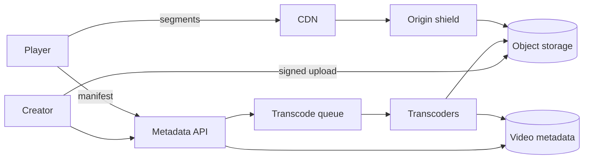

# Exercise 5: Video Streaming Platform

Worked solution. Try the problem for 35 minutes before reading past the requirements. The production counterparts are [YouTube video delivery](../../case-studies/youtube-video-delivery.md) and [Netflix streaming](../../case-studies/netflix-streaming-architecture.md). Read those after you have your own design.

## Problem

Users upload videos and other users watch them, with little buffering, on devices from phones to televisions, including across regions.

In scope: upload, transcode, store, play, pick a quality, distribute. Out of scope: a social graph, comments, and a recommendation model. Live streaming is a follow-up, not the base design.

## Requirements

**Functional**

- Upload a video and receive a watchable URL when processing finishes.
- Play with adaptive bitrate: the client switches quality as bandwidth changes.
- Resume, seek, and serve the same title to many viewers.
- A creator can set a video private or delete it, and playback of a deleted or private video stops.

**Non-functional**

- Start of playback: under 2 seconds for a cached title in-region.
- Rebuffering is the quality metric that matters, not server CPU.
- A popular title must not require the origin to emit one stream per viewer.
- Durability: an uploaded master is not lost if a disk fails. Playback availability target: 99.9%.

## Capacity estimates

Assumptions:

- 5 million uploads per day. Average master file 1 GB. Average duration 10 minutes.
- 50 million viewers per day, each watching 1 hour.
- Typical delivered bitrate 2 Mbit/s (a mix of 360p through 1080p).
- Peak watch concurrency 5× the average.

```
uploads/sec average     = 5e6 / 86400 ≈ 60
upload ingress          = 60 × 1 GB ≈ 60 GB/s   (bursty; size the ingest tier for this, or queue)
transcode               = 5e6 × 10 min × several renditions per day
                        ≈ real-time factor: budget a large batch cluster, not the request path
watch-hours/day         = 5e7
delivered bytes/day     = 5e7 hours × 3600 s × 2e6 bit/s / 8
                        = 5e7 × 9e8 bytes
                        = 45 PB/day
average egress          = 45e15 / 86400 ≈ 520 GB/s
peak egress             = ~2.5 TB/s if the peak is 5×
origin storage          = masters + renditions
                        ≈ 5e6 × 1 GB masters, plus ~0.5 GB of renditions each
                        ≈ 7.5 PB per day of new video, before replication and retention policy
```

45 PB/day is the number that decides the architecture. No application fleet serves that from one region. The bytes have to come from a CDN cache sitting close to the viewer. The origin stores and fills caches; it does not play the video to each user.

Upload ingress of 60 GB/s is large but parallel and not latency-sensitive. Transcode is offline. The synchronous path is metadata and playback manifests, which are tiny.

If your interview numbers are 100× smaller, the shape does not change until the CDN is no longer paying for itself. Say the assumption, then draw the CDN anyway, because the failure mode of "one origin, many viewers" shows up as soon as a single video goes viral.

## API

```
POST /v1/videos              → { "video_id", "upload_url" }     # upload URL is direct to object storage
POST /v1/videos/{id}/complete
GET  /v1/videos/{id}         → { "status": "processing" | "ready", "title", ... }
GET  /v1/videos/{id}/manifest.mpd    # or .m3u8, authorized
DELETE /v1/videos/{id}
```

The master file goes **directly from the client to object storage** using a signed URL that expires in minutes and is scoped to that object. API servers never proxy the bytes. Completion notifies the transcoder via a queue.

Playback:

```
GET manifest → list of renditions and segment URLs (or a template)
GET segment  → bytes, from the CDN, cacheable, content-addressed
```

## Data model

```
videos
  video_id, owner_id, status, visibility, title, created_at, deleted_at

renditions
  video_id, rendition_id, codec, height, bitrate, segment_seconds, path_prefix

objects
  master and segments live in object storage, not in the database
  path: /masters/{video_id}
        /renditions/{video_id}/{rendition_id}/seg_{n}.ext
```

The database row is small. Authorization checks the row. The CDN does not know how to do that check unless the segment URL is signed or the manifest is the only authorized step and segments are unguessable and access-controlled. For a public video, segments can be public and cached forever (they are immutable). For a private video, segment URLs are signed and expire in a few minutes, and `Cache-Control` is private or the signature is part of the cache key. Deletion tombstones the row and enqueues a purge of the CDN path plus a delete of the objects.

## Architecture



The player, not the server, picks the next rendition based on measured throughput and buffer level. The server's job is to offer a ladder of renditions and to make each segment independently cacheable.

## Deep dive: adaptive bitrate and the cache

**Ladder.** For each master, produce a small set of renditions, for example 240p, 480p, 720p, 1080p, at fixed bitrates, in 4-second segments. Align segment boundaries across renditions so a switch happens on a boundary and does not restart the decoder timeline. Store the ladder in the manifest.

Four-second segments are a trade against startup: shorter segments start faster and switch faster, and they reduce CDN efficiency (more requests, worse byte-to-header ratio). Four seconds is a reasonable default; say you would measure rebuffering before tuning it.

**Why the CDN hits.** A viral video's segments are requested by millions of viewers and change never. Cache them at the edge. The origin should see one fill per segment per edge, not one fill per viewer. An origin shield (a cache in front of object storage) collapses the fill from many edges.

**Upload and transcode are not the play path.** Workers pull the master, write segments, and mark the video `ready`. A failure retries the rendition, idempotently: segment keys are content-addressed or overwritten by the same path. The user watches nothing until `ready`, except an optional "original file" progressive download if you want a faster first publish. We do not block the watch path on the fanciest codec.

**Codec cost.** Producing AV1 saves bandwidth and spends CPU. Spend it on the titles that are actually watched (a second pass), and ship a widely decodable codec (H.264 or VP9) in the first pass so time-to-ready stays short. Netflix's encode-once, serve-many lesson is the same arithmetic: encode cost is noise next to delivery cost, but only for titles people watch. See [Netflix](../../case-studies/netflix-streaming-architecture.md).

**Start time.** The manifest and the first segments of the lowest reasonable rendition should be cached at the edge. The player requests a short first segment immediately. 2 seconds is mostly "is the first segment close to the user," which is a CDN question, not an API question.

## Trade-offs

| Decision | Gain | Cost |
|----------|------|------|
| CDN in front of immutable segments | Origin survives a viral video; start time is a regional cache hit | Private and just-deleted videos require signed URLs and purges. A purge is not instant. |
| Direct-to-storage upload | API tier does not carry 60 GB/s | More moving parts (signed URLs, completion callback, orphaned uploads to garbage-collect). |
| Async transcode | Uploads stay reliable and retries are easy | The video is not watchable for minutes. We expose `status` rather than pretending it is instant. |
| Fixed ladder, client-side switch | Simple servers, works offline of any per-user session | We may over-send quality on a confusing network. A per-title encode ladder (better compression at the same quality) is a later optimization for hot titles. |
| Public segments for public videos | Cache hit ratio is high | Anyone with the URL can fetch it. Security for private video is a different cache policy, not a hope that the URL stays secret forever. |

## Failure and DRM

- **Object storage node loss:** replication inside the storage system (erasure coding or 3 copies). The master is the durable artifact. Renditions are derived and can be rebuilt, like a search index.
- **Transcode backlog:** plays of old video are unaffected, because they do not share a queue with uploads. Scale workers on queue age.
- **Region loss of an origin:** a second region holds masters (asynchronous replication is acceptable; the worst case is the last few uploads). Edges fail over to the other origin. Viewers do not notice if the segment was already cached.
- **Hot title, cold cache:** the first minute of a broadcast premiere can stampede the origin. Pre-warm the first segments of titles you know will be hot, the same move as [Shopify pre-warming a flash sale](../../case-studies/shopify-flash-sale-scaling.md).
- **DRM.** Encryption keys are a separate, small, strongly authenticated service. The CDN caches ciphertext. The player fetches a license only if the user is allowed. DRM does not belong in the byte path, and it does not make the cache useless. If the interview has no rights requirement, say you are not building DRM and that private videos use signed URLs instead.

## Follow-ups

1. **Encoding efficiently.** One widely playable ladder first, expensive codecs for titles that earn the CPU, segment alignment so switching is cheap.
2. **Buffering.** Short start segments, CDN close to the user, client adapts down before the buffer hits zero.
3. **Global latency.** Cache at the edge, origin shield in front of storage, masters replicated to a second region.
4. **DRM.** License service beside the path, ciphertext in the CDN, or signed URLs if all you need is private access.

## Related reading

- [Lecture 1: Designing for Scale](../lectures/lecture-01-designing-for-scale.md) — the egress number is the bottleneck.
- [Lecture 2: Multi-region](../lectures/lecture-02-global-multi-region.md) — edges versus home-region metadata.
- [YouTube video delivery](../../case-studies/youtube-video-delivery.md)
- [Netflix streaming architecture](../../case-studies/netflix-streaming-architecture.md)
